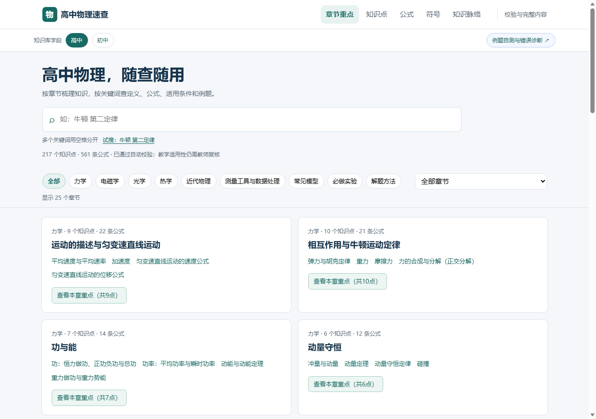

# 高中物理知识库

供学生复习、教师查阅的离线物理知识点资料库。支持章节重点概览、多关键词搜索、公式与符号索引、例题自测和错误诊断。

**日常入口：[打开高中速查页](outputs/quick.html)。** GitHub显示源码时，可下载仓库ZIP、解压后双击该HTML。请保留整个outputs文件夹，跨学段切换和练习回看需要同目录页面。

更新日期：2026-10-18。本轮改善了章节检索和手机查阅，补齐了两学段之间的离线页面。历史收尾说明不代表当前界面状态。

## 如何使用

1. 打开速查页，选择“查看本章重点”，快速浏览定义和代表公式；点击知识点查看适用条件、推导、易错点和例题。
2. 在搜索框输入多个关键词，用空格分开，例如“牛顿 第二定律”“平抛 速度”“欧姆 电阻”。标题命中优先，找不到时可一键清除筛选。
3. 可切换知识点、公式、符号和知识脉络，或打印当前章节概览。
4. 练习页支持查看解析和导出学习记录。开放例题由学生自评；机器诊断与教师点评分别显示。

## 本学段数据

| 内容 | 数量 |
|---|---:|
| 章节 | 25 |
| 知识点 | 217 |
| 公式 | 561 |
| 自动检查 | 2764 |
| 诊断题 | 464（机器可判307、教师点评157） |

两学段合计330个知识点、780条公式、4119项自动检查、742道诊断题。742是两学段总数，不是本学段题目数。

## 正确性和使用边界

公式来自结构化内容源，并执行量纲、单位、数值、方向、跨关系等自动检查和独立复算。**自动检查通过不等于教师审核通过。**

742道诊断题仍待教师审核；7份实验方案尚待实物验证；跨学段线索和部分教材分节覆盖仍待教师核对。章节概览沿用已有内容，不宣称考试权重或教材完整认证。没有把自动测试冒充真实师生试用。

学习记录保存在当前浏览器，不自动同步，清理数据前请导出。无须API Key、账号或网络。

## 文件与复现

- `outputs/quick.html`：建议的日常阅读入口。
- `outputs/index.html`、`outputs/junior.html`：完整内容和自动校验记录。
- `outputs/quiz-hs.html`、`outputs/quiz-junior.html`：两学段练习。
- `outputs/产品审查_2026-10-18/审查与改进说明.md`：本轮发现、修复、验收与保留边界。
- `work/kb/`、`work/kb_junior/`：两学段源数据。
- `work/build_all.py`：统一构建；只用Python标准库。

两个公开仓库均保留完整跨学段页面与构建所需数据，方便直接下载使用。冻结校验器与质检基线在本轮保持原样。构建和机器检查的结果不替代独立教学审核。
